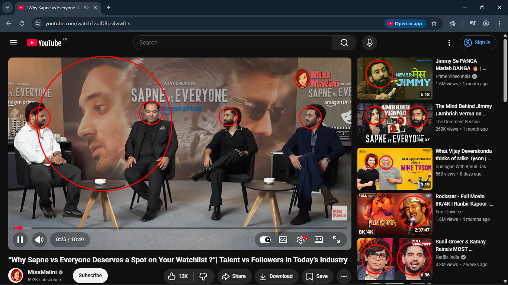
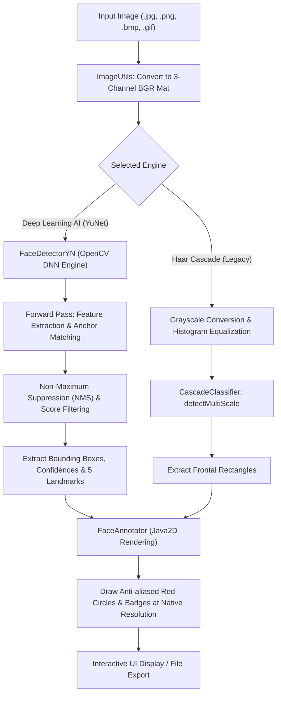

# 🎯 AI Face Detection System

An intelligent, high-performance desktop and command-line face detection system built in **Java 21** and powered by **OpenCV 4.10** with deep neural network inference (**YuNet CNN**).

Designed to accurately detect faces in real-world scenarios—including **multi-person crowds**, **side profiles**, **tilted angles**, **challenging lighting**, and **partial occlusions**—with automatic high-resolution red circle annotation, facial landmark localization, and batch processing.

---

## 📸 Detection Result Preview



*Detected faces circled in crisp red, with optional confidence percentage badges and facial landmark points.*

---

## 🚀 Key Features

* **🧠 Deep Learning AI Engine (YuNet)**: Built-in ONNX convolutional neural network designed specifically for wild-setting face detection:
  * **Side Poses & Profiles**: Reliably detects faces turned sideways (up to 90°), looking up/down, or tilted.
  * **Multi-Person Groups & Crowds**: Identifies numerous faces across high-resolution photos without missing turned or partially occluded individuals.
  * **5 Facial Landmarks**: Pinpoints right eye, left eye, nose tip, right mouth corner, and left mouth corner coordinates.
  * **Confidence Scoring**: Calculates detection probability (0–100%) for every detected face.
* **🎚️ Interactive GUI Controls**:
  * **Dual Engine Switcher**: Toggle seamlessly between modern **Deep Learning AI (YuNet)** and **Haar Cascade (Legacy)**.
  * **Sensitivity / Confidence Slider**: Dynamically adjust detection threshold (10% to 95%) to detect subtle or shaded faces.
  * **Visual Badges**: Checkboxes to toggle confidence percentage tags and landmark dots on and off in real time.
* **📁 Batch Folder Processing**: Point the tool at any directory to automatically scan, detect, and export annotated copies into an `output/` subfolder.
* **💻 Headless CLI Mode**: Execute detection in scripts, pipelines, or command terminals.
* **📦 100% Self-Contained & Offline**: All native OpenCV binaries and neural network weights are packaged inside the runnable JAR. Zero external model downloads or internet connection required at runtime.

---

## ⚙️ How It Works (System Architecture)



### Step-by-Step Pipeline

1. **Ingestion & Matrix Conversion ([`ImageUtils.java`](src/main/java/com/facedetector/ImageUtils.java))**:
   The input image is decoded via `ImageIO` and transformed into an OpenCV `CV_8UC3` BGR matrix (`Mat`). Image color spaces, strides, and formats (JPEG, PNG, BMP, GIF) are standardized.

2. **Neural Network Inference ([`FaceDetector.java`](src/main/java/com/facedetector/FaceDetector.java))**:
   * The bundled YuNet ONNX model is executed using OpenCV’s native DNN backend.
   * Input dimensions are dynamically synchronized to the image dimensions (`setInputSize`), enabling detection on both small crops and high-resolution group photographs.
   * The model computes feature pyramids to detect faces of diverse scales simultaneously.

3. **Post-Processing & Filtering**:
   * **Score Thresholding**: Rejects candidates below the user-selected confidence threshold.
   * **Non-Maximum Suppression (NMS)**: Eliminates duplicate overlapping detections around the same face.
   * **Landmark Localization**: Extracts 5 coordinate pairs per face (eyes, nose, mouth corners).

4. **High-Resolution Vector Annotation ([`FaceAnnotator.java`](src/main/java/com/facedetector/FaceAnnotator.java))**:
   * Uses Java2D vector graphics with anti-aliasing (`RenderingHints.VALUE_ANTIALIAS_ON`) to draw smooth red circles centered on each face bounding box.
   * Stroke thickness automatically scales proportionally to image resolution, ensuring clear visibility on 720p, 1080p, and 4K+ images alike.
   * Optionally stamps semi-transparent confidence badges (e.g. `94%`) and colored landmark dots.

---

## 🛠️ Requirements

* **OS**: Windows 10/11 x64
* **Java**: JDK 21+
* **Maven**: Apache Maven 3.9+ (for building from source)
* Pre-configured to use JDK 21 and Maven under `%LOCALAPPDATA%\Tools` (no environment variable setup required when using the provided scripts).

---

## 🚦 Quick Start

### 1. Launch the Desktop GUI

Double-click **`run.cmd`** in the project folder, or run in PowerShell:

```powershell
.\run.cmd
```

*(Alternatively: `java -jar target\face-detector.jar`)*

#### GUI Instructions:
1. Click **Open Image** and choose any photo.
2. Ensure **Engine** is set to `Deep Learning AI (YuNet)`.
3. *(Optional)* Adjust the **Confidence** slider (e.g. 40%–50% for difficult side angles or 60%–70% for strict detection).
4. Click **Detect Faces** to see the red circle annotations.
5. Click **Save Result** to export the annotated image.
6. To process multiple photos at once, click **Open Folder (Batch)** and select a folder of images.

---

### 2. Command Line (CLI) Usage

Run headless from PowerShell or Command Prompt:

```powershell
# Detect faces in a single photo (saves photo_faces.png next to original)
java -jar target\face-detector.jar images\photo.jpg

# Specify custom output path
java -jar target\face-detector.jar images\photo.jpg results\output.png

# Show confidence percentage badges and facial landmarks
java -jar target\face-detector.jar images\photo.jpg --show-score --show-landmarks

# Adjust confidence threshold (e.g., 0.4 = 40%)
java -jar target\face-detector.jar images\photo.jpg --confidence 0.4

# Batch process an entire directory into an output folder
java -jar target\face-detector.jar images images\output

# Use legacy Haar Cascade model
java -jar target\face-detector.jar images\photo.jpg --model haar
```

---

## 🏗️ Project Structure

```
face-detection-system/
├── images/                             # Sample images and demo results
│   ├── detection_result.png            # Demonstration screenshot
│   └── lena_ai_faces.png               # AI detection test output
├── src/
│   ├── main/
│   │   ├── java/com/facedetector/
│   │   │   ├── Main.java               # Entry point (GUI launcher & CLI dispatcher)
│   │   │   ├── FaceDetector.java       # OpenCV YuNet DNN & Haar Cascade detector
│   │   │   ├── FaceDetectionService.java# High-level single & batch image processing
│   │   │   ├── FaceAnnotator.java      # Java2D circle, badge & landmark rendering
│   │   │   ├── Face.java               # Face bounding box, confidence & geometry
│   │   │   ├── FaceLandmark.java       # Facial landmark coordinates record
│   │   │   ├── DetectorType.java       # Engine mode enum (YUNET vs HAAR_CASCADE)
│   │   │   ├── AnnotationOptions.java  # Visual display toggles record
│   │   │   ├── ImageUtils.java         # Image I/O, format conversions & resource extraction
│   │   │   ├── DetectionResult.java    # Single-image detection metrics record
│   │   │   ├── BatchResult.java        # Batch processing summary record
│   │   │   ├── FileResult.java         # Individual file batch outcome record
│   │   │   └── ui/
│   │   │       ├── MainWindow.java     # Swing GUI with toolbar, controls & progress bar
│   │   │       └── ImagePanel.java     # Scaled, anti-aliased image preview canvas
│   │   └── resources/
│   │       ├── face_detection_yunet_2023mar.onnx  # YuNet Deep Learning model
│   │       └── haarcascade_frontalface_default.xml # Legacy Haar cascade model
│   └── test/
│       ├── java/com/facedetector/
│       │   └── FaceDetectorTest.java   # Unit tests (multi-face, side-angle, landmarks)
│       └── resources/
│           └── lena.jpg                # Standard test image
├── build.cmd                           # Build script (Maven clean package)
├── run.cmd                             # One-click launcher script
├── pom.xml                             # Maven build configuration & OpenCV dependencies
└── README.md                           # Documentation
```

---

## 🔨 Building from Source

To compile and produce a standalone shaded JAR:

```powershell
.\build.cmd
```

Or using Maven directly:

```powershell
mvn clean package
```

The compiled runnable JAR is output to:
```
target\face-detector.jar
```

To run all unit tests:
```powershell
mvn test
```

---

## 📊 Comparison: YuNet Deep Learning vs. Classical Haar Cascade

| Feature | 🧠 Deep Learning AI (YuNet) | 🏛️ Haar Cascade (Classical) |
| :--- | :---: | :---: |
| **Side Poses & Profiles (Up to 90°)** | ✅ Excellent | ❌ Fails completely |
| **Tilted & Angled Faces** | ✅ Accurate | ❌ Frequently missed |
| **Multi-Person Crowds** | ✅ High accuracy | ⚠️ High false-negative rate |
| **Facial Landmarks (5 Points)** | ✅ Eyes, nose, mouth | ❌ None |
| **Confidence Scoring** | ✅ 0–100% Probability | ❌ Binary / uncalibrated |
| **Speed** | ⚡ ~20–50 ms (CPU) | ⚡ ~20–40 ms (CPU) |
| **Robustness to Shadows & Lighting** | ✅ Strong | ❌ Sensitive to uneven light |

---

## 📜 License

This project is licensed under the MIT License. OpenCV and YuNet are released under the Apache 2.0 License.
"# face-detection-java-based" 
